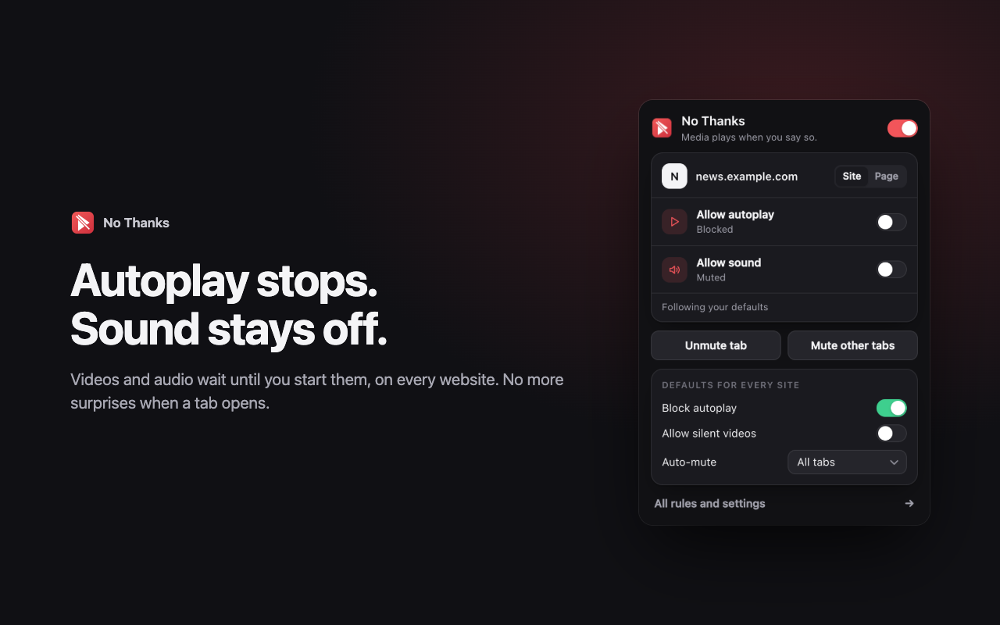
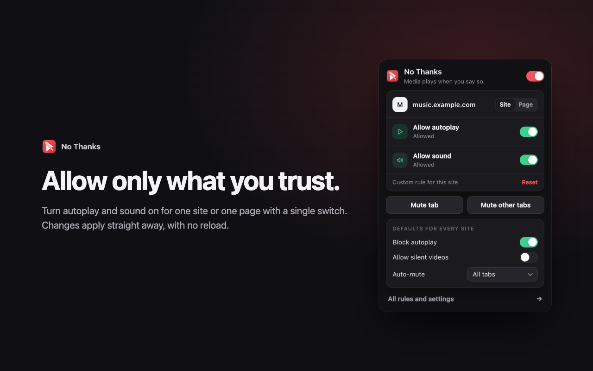
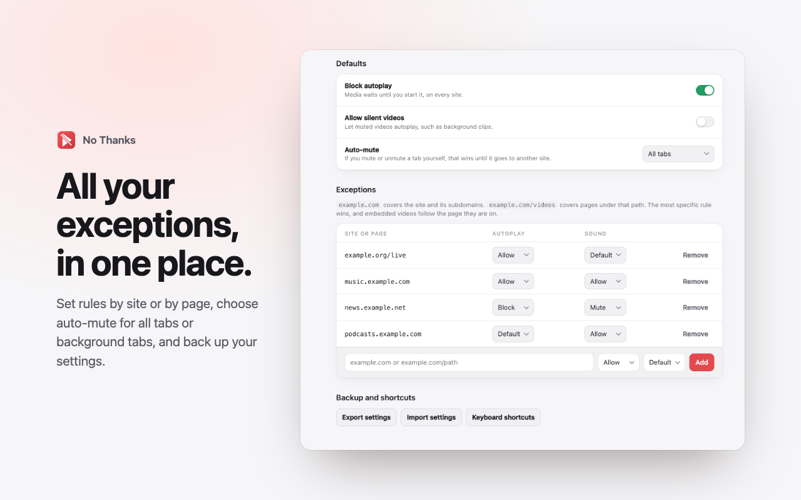
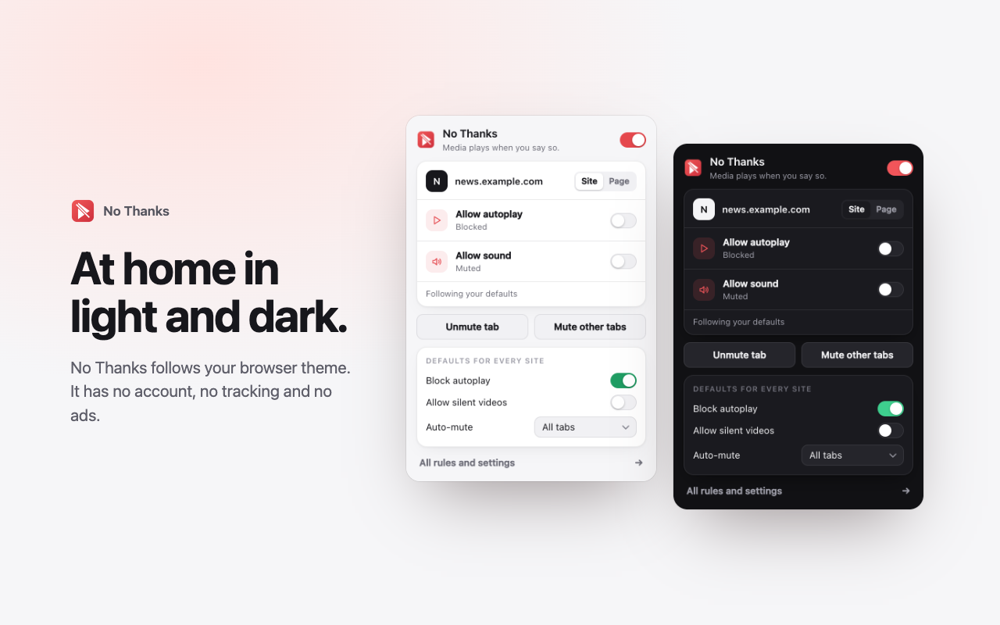

<p align="center"></p>
<h1 align="center">No Thanks</h1>
<p align="center">Stop autoplay and auto-mute tabs on any website, in Chrome and Edge.<br>Media plays when you say so.</p>



## Features

- **Blocks autoplay everywhere.** Video and audio wait until you start them. This covers the `autoplay` attribute, script `play()` calls and embedded players.
- **Mutes tabs automatically.** Choose all tabs, background tabs only (just the active tab plays), or off.
- **Exceptions for a site or a page.** `example.com` covers the site and its subdomains. `example.com/videos` covers pages under that path. The most specific rule wins.
- **Quick controls.** Use the popup, or right-click the page or toolbar icon. Each one shows the current state, and changes apply with no reload.
- **Your choice wins.** If you mute or unmute a tab yourself, auto-mute leaves it alone until that tab goes to another site.
- **Shortcuts.** `Alt+Shift+M` mutes or unmutes the tab. `Alt+Shift+O` mutes all other tabs.
- **Sync and backup.** Settings sync through your browser account, and you can export or import them as JSON.
- **Private.** No account, no tracking, no ads, and nothing is sent to any server. See the [privacy policy](PRIVACY.md).

By default, autoplay is blocked, all tabs are muted, and silent videos are blocked too.





## Install from source

1. Download or clone this repository.
2. Open `chrome://extensions` (or `edge://extensions`).
3. Turn on **Developer mode**.
4. Click **Load unpacked** and select the repository folder.

## How autoplay blocking works

A click only counts as starting media if it lands on that video or its player, and the page address has not changed since. So opening a video from a thumbnail does not start it, and neither does a player moving on to the next video. To start it, click the video or press a key such as Space.

## Known limits

- A very brief moment of sound is possible if a page starts media before the extension has finished starting up.
- A site written specifically to target this extension could get around the block.
- About 150 exceptions fit in synced browser storage.
- Browser pages such as `chrome://` and the extension stores cannot be controlled by extensions.

## Development

Run the rule tests:

```bash
node test.js
```

Build the zip that is uploaded to the stores:

```bash
mkdir -p dist && zip -r dist/no-thanks.zip manifest.json *.js *.html style.css icons -x test.js
```

## License

[MIT](LICENSE)
